# My Friend — Virtual Pet & Watch Face (Wear OS / Galaxy Watch)

Bichinho virtual retrô desenhado numa grade LCD `52x52` para **Wear OS (Galaxy Watch)**. Funciona como aplicativo e como **Watch Face** interativa, escrito 100% em Java puro (zero dependências externas, APK de ~40 KB) e pensado para gastar o mínimo de bateria.

<table>
  <tr>
    <td align="center">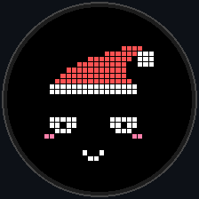<br><sub>Parado, olhando em volta</sub></td>
    <td align="center">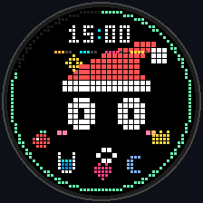<br><sub>Toque mostra o HUD; comendo</sub></td>
    <td align="center">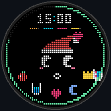<br><sub>Bebendo água</sub></td>
    <td align="center">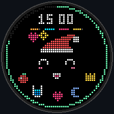<br><sub>Carinho com o dedo</sub></td>
  </tr>
  <tr>
    <td align="center">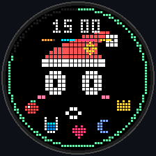<br><sub>Loja com abas na borda</sub></td>
    <td align="center">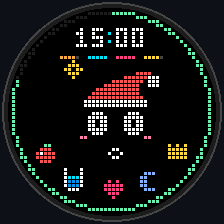<br><sub>Cutucou demais: birra</sub></td>
    <td align="center">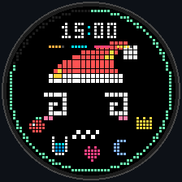<br><sub>Chacoalhou o pulso: tonto</sub></td>
    <td align="center">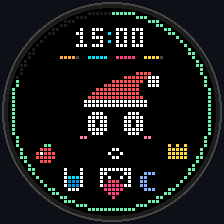<br><sub>Chegou mensagem</sub></td>
  </tr>
  <tr>
    <td align="center">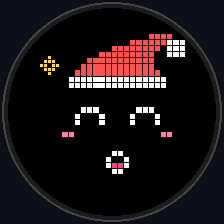<br><sub>Bateu a meta de passos</sub></td>
    <td align="center">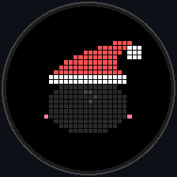<br><sub>Emburrado; um toque e ele se vira</sub></td>
    <td align="center">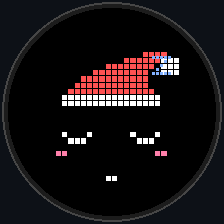<br><sub>Dormindo à noite</sub></td>
    <td align="center">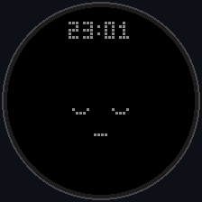<br><sub>Tela desligada (ambient)</sub></td>
  </tr>
</table>

## O que ele faz

- **Necessidades:** fome, água, felicidade e energia zeram em até 3 horas acordado — precisa cuidar dele sempre. Dormindo, tudo cai bem devagar.
- **Rotina:** boceja à noite, dorme sozinho quando você apaga a tela depois das 23h e acorda se espreguiçando de manhã.
- **Reage a você:** fica animado quando você caminha, comemora a meta de 6000 passos (+100 moedas), fica tonto se o pulso chacoalhar e segura um envelopinho quando chega mensagem.
- **Personalidade:** cada dia sorteia um humor — normal, preguiçoso, elétrico ou carente.
- **Sentimentos:** fica bravo se for cutucado demais (e a birra aumenta se continuar), triste sem carinho ou com cocô acumulado, e emburrado de costas se ficar 3h+ sem você olhar.
- **Loja:** 5 categorias — chapéus (inclui orelhas de gatinho e boné de hélice que gira), nariz, olhos, pescoço (gravatinha, cachecol, chupeta, colar), coisas para segurar (flor, espada, poção, varinha, balão, pirulito, sorvete, microfone, guarda-chuva).
- **Lancheira:** tocar na comida ou no copo abre o cardápio (só ícones, sem texto). Maçã e água são grátis; dá para comprar banana, melancia, biscoito, rosquinha, bolinho de arroz, pizza, hambúrguer e cupcake, e suco, leite, refrigerante, milk-shake e chá com bolinhas. Comprou uma vez, é seu para sempre.
- **Watch Face:** relógio, data, anel de bateria na borda e modo tela desligada em cinza que muda só uma vez por minuto.
- **Backup:** moedas, itens e status entram no backup do relógio.

## Controles

- **Toque no bichinho:** cutuca (5 rápidas = bravo). Na primeira vez só mostra o HUD.
- **Arrastar o dedo ou girar a coroa/bezel:** carinho (+felicidade, +moeda).
- **Toque no topo:** alterna relógio e data.
- **Ícones na borda de baixo:** comer | água | carinho | dormir/acordar | loja.
- **Toque no cocô (à esquerda):** dá banho.
- **Na loja:** abas em arco na borda, ‹ › trocam o item, o meio de baixo (ou o próprio bichinho) compra/usa, o topo fecha.

## Bateria

- A tela não é mantida acesa; com a tela parada ele desenha ~2 quadros por segundo e só anima a 60 fps durante movimentos de verdade.
- Sensores (passos em lote e acelerômetro em taxa baixa) só ficam ligados com a tela acesa.
- Tela desligada: um quadro por minuto, sem sensores nem loop.
- Notificações só anotam a hora; nada acorda a tela.
- Lembretes de fome/sede não acordam o relógio de madrugada.

## Simulador de PC

O mesmo motor roda numa janela no PC (`desktop-sim/`), útil para testar sem o relógio:

```bash
desktop-sim/run.bat
```

Mouse = toque, rodinha = coroa, **M / Shift+M** = mostrar cada humor, S/G = passos, D = chacoalhar, N = mensagem, H = +1 hora, U = +1 dia, A = tela desligada, setas = bateria, C = carregador.

## Arquitetura (`v1.16.0`)

A explicação completa, do pixel ao relógio, está em [`docs/ARQUITETURA.md`](docs/ARQUITETURA.md).
A versão desenhada é o [`docs/como-funciona.excalidraw`](docs/como-funciona.excalidraw)
(abra em <https://excalidraw.com>), com uma cópia em imagem em [`docs/como-funciona.png`](docs/como-funciona.png).

Resumo dos arquivos:

- **`PetConfig.java`** — balanceamento, decaimento, preços, itens, humores e horários.
- **`PetState.java`** — persistência em `SharedPreferences` e decaimento exato com a tela apagada (acordado e dormindo).
- **`PixelGrid.java`** — grade `52x52` adaptável à resolução, paleta pré-alocada, fontes `3x5`, sprites `5x5`.
- **`PetAccessoryRenderer.java`** — acessórios da loja, comidas e bebidas, objetos (envelope), relógio e anel de bateria.
- **`PetEngine.java`** — motor: simulação, humores, rotina do dia, física (olhar, piscar, pulo), partículas, entrada e agendamento de quadros para economizar bateria.
- **`PetClock.java` / `PetSignals.java`** — hora (com deslocamento para o simulador) e sinais vindos de fora (notificações).
- **`PetSensors.java`** — contador de passos e detecção de chacoalhar, só com a tela acesa.
- **`PetNotificationListener.java`** — avisa o bichinho quando chega mensagem.
- **`FriendView.java` / `MainActivity.java`** — app standalone.
- **`FriendWatchFaceService.java`** — Watch Face (`WallpaperService`) com modo ambient.
- **`ReminderReceiver.java`** — lembretes em segundo plano (bateria, sede, fome), pausados à noite.
- **`SetWatchFaceTool.java`** — ativa a Watch Face via ADB.

Ideias futuras ficam em [`IDEIAS.md`](IDEIAS.md).

## Compilação e instalação via ADB (Wi-Fi)

No Windows, o jeito curto é `instalar.bat`: ele compila, acha o relógio no Wi-Fi (última porta
usada ou descoberta automática) e instala por cima. `instalar.bat -Mostrador` também abre o
seletor de mostrador. Para as atualizações entrarem por cima a partir de qualquer PC, rode
`criar-chave.bat` uma vez: ele cria a chave fixa de assinatura (fora do git).

Passo a passo manual:

```bash
# 1. Compilar o APK de release (R8, assinado para instalação direta)
./gradlew assembleRelease

# 2. Instalar no relógio (Depuração Wi-Fi)
adb install -r app/build/outputs/apk/release/app-release.apk

# 3. Permissão de passos e acesso às notificações (envelope de mensagem)
adb shell pm grant com.myfriend android.permission.ACTIVITY_RECOGNITION
adb shell cmd notification allow_listener com.myfriend/com.myfriend.PetNotificationListener

# 4. (Opcional) Ativar a Watch Face direto pelo ADB
adb shell 'CLASSPATH=$(pm path com.myfriend | cut -d: -f2) app_process / com.myfriend.SetWatchFaceTool'
```
